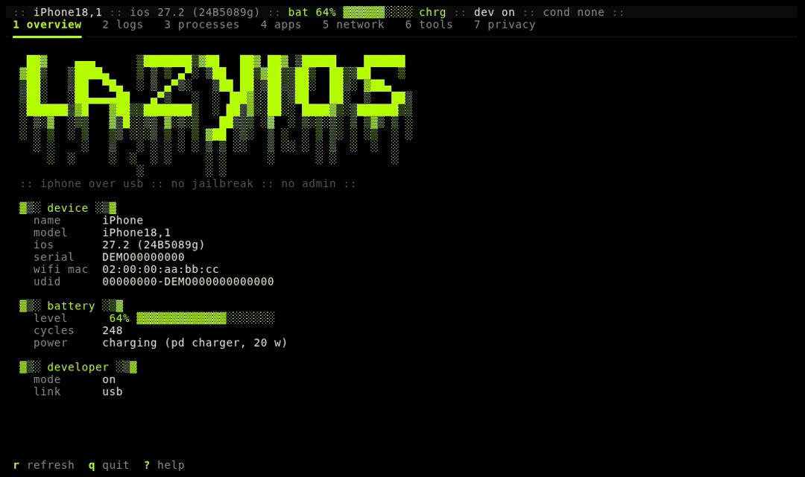

# lazyios

[](https://github.com/Manuel-1312/lazyios/actions/workflows/ci.yml)
[](https://pypi.org/project/lazyios/)
[](LICENSE)

Like lazygit, but for your iPhone. A keyboard-driven terminal app that talks to an iPhone over USB: read the system log, list and kill processes, launch apps, capture network traffic to a `.pcap`, throttle the network, take screenshots, fake a location, watch FPS. It runs on Windows, macOS and Linux, needs no jailbreak, no Xcode and no admin rights. Built on [Textual](https://github.com/Textualize/textual), using [pymobiledevice3](https://github.com/doronz88/pymobiledevice3) as a library.



## Who is your iPhone talking to?

See which apps on your iPhone talk to which servers and trackers, live, without a proxy, a VPN profile or a jailbreak.

Press `space` to start a capture, use your phone, then open the `privacy` tab: every app gets one row per domain it contacted, with the tracker category and company when the domain is a known tracker, plus flows, bytes and last activity. Export the session as JSON and CSV with `e`.

How it works: the capture is the phone's own packet stream over USB. Domains come from the DNS answers the phone receives and from the server name in each TLS handshake; both are matched to the app that owns the connection. Tracker data is the [AdGuard companiesdb](https://github.com/AdguardTeam/companiesdb).

iOS has its own App Privacy Report (Settings > Privacy & Security) that logs domains per app after the fact. lazyios adds live per-connection data (bytes, flows, IPs) and an export you can diff, grep or open in a spreadsheet.

Limits, said plainly:

- Apps that use encrypted DNS, iCloud Private Relay, or QUIC without a visible DNS lookup show up as bare IP addresses.
- The capture only sees the phone's own traffic, and only while it is plugged in.
- Names come from unencrypted DNS answers and the TLS server name (SNI) seen on the wire. Neither is authenticated, so treat them as hints. DNS over HTTPS/TLS, Encrypted Client Hello, QUIC and iCloud Private Relay are invisible, and those rows fall back to the bare IP.
- "Tracker" means an ads, analytics or telemetry endpoint according to AdGuard's companiesdb. It is not a verdict on the app.

Tracker data: AdGuard companiesdb, [CC BY-SA 4.0](https://creativecommons.org/licenses/by-sa/4.0/), reduced to domain, category and company (see `src/lazyios/data/TRACKERS-LICENSE.md`).

## Features

- overview: device info, battery (level, cycles, health against design capacity, voltage, current, charger), developer mode state, `a` security audit
- logs: live syslog with level colors, filter, pause, bounded buffer
- processes: list, filter, kill (with confirmation), launch by bundle id, `m` live CPU, memory and network (bytes in and out per second) per process with a CPU history sparkline
- apps: installed user apps, launch with enter
- network: packet capture to a real `.pcap` with a live table, open in Wireshark; network, thermal and GPU conditions
- privacy: which app talks to which domain, known trackers flagged, how each name was learned (TLS SNI, DNS or none), filter, sort, JSON and CSV export
- conns: every connection from the capture with app, pid, endpoints, bytes up and down, new vs returning destinations, domain with a confidence level, `app:` `domain:` `ip:` `port:` `proto:` filters, JSON/CSV export with a SHA-256 file
- score: a privacy score per app with every point taken off explained, tracker companies, domains new since earlier captures of the same phone (and whether the app was updated in between), configurable alerts
- timeline: one time-ordered list of device connects and losses, captures, first contacts, network interfaces, syslog errors (folded per process and minute), conditions, app and process starts and exits, alerts and anomalies; time filters, JSON/CSV export
- anomalies: traffic spikes, connections at a steady interval (beaconing), bursts of never-seen domains and big changes against earlier sessions, each with the numbers behind it
- tools: screenshot, location simulation, FPS sparkline
- devices: `d` lists every connected device (model, iOS, trust) and switches to another one; plugs and unplugs are noticed, and a device that comes back reconnects on its own
- `--demo` runs on fake data, no device needed

## Install

Easiest first.

**1. Download a binary.** Grab `lazyios-windows-x64.exe`, `lazyios-macos-arm64` or `lazyios-linux-x64` from the [Releases](https://github.com/Manuel-1312/lazyios/releases) page and run it from a terminal. Nothing else to install (on macOS and Linux run `chmod +x` first).
The Windows exe is not code-signed, so SmartScreen may say "Windows protected your PC": click *More info*, then *Run anyway*. To check the download, compare its hash with the `SHA256SUMS` file from the same release:

```
Get-FileHash lazyios-windows-x64.exe -Algorithm SHA256   # PowerShell
sha256sum -c SHA256SUMS --ignore-missing                  # Linux
shasum -a 256 -c SHA256SUMS --ignore-missing              # macOS
```

**2. One-liner.** Installs [uv](https://docs.astral.sh/uv/) if needed, then lazyios. No admin or sudo.

```
irm https://raw.githubusercontent.com/Manuel-1312/lazyios/main/install.ps1 | iex      # Windows
curl -LsSf https://raw.githubusercontent.com/Manuel-1312/lazyios/main/install.sh | sh  # macOS, Linux
```

**3. From PyPI.**

```
uv tool install --python 3.12 lazyios
pipx install --python python3.12 lazyios
```

Use Python 3.12: on newer versions a few pymobiledevice3 dependencies have no prebuilt wheels yet and pip tries to compile them.

## Requirements

- An iPhone that trusts this computer. Developer Mode must be on for processes, conditions and tools.
- Windows: the Apple Devices app (`winget install 9NP83LWLPZ9K -s msstore`) or iTunes, for usbmuxd. If Apple Devices is installed but not running, lazyios starts it for you.
- macOS: nothing extra.
- Linux: the `usbmuxd` package (`sudo apt install usbmuxd` or your distro's equivalent).
- Python 3.10+ only for the pip/uv installs.

## Usage

```
lazyios [--udid UDID] [--out DIR] [--max-capture-mb MB] [--keep-sessions N]
        [--keep-files N] [--anonymize KINDS] [--log-level LEVEL] [--demo]
lazyios --version
lazyios --selftest
python -m lazyios
```

Each device gets its own folder, named after its UDID: captures, screenshots, reports and session history go to `~/lazyios/<udid>/captures`, `screenshots`, `reports` and `sessions` (`--out` changes `~/lazyios`). Settings files (`alerts.json`, `anomaly.json`) stay in `~/lazyios`. Before 0.3, files went straight into `~/lazyios/captures` and the like; they are left where they are. A capture stops by itself when its pcap reaches `--max-capture-mb` (1024 by default).

| key | action |
| --- | --- |
| `1`-`9`, `0` | switch tab |
| `q` | quit |
| `ctrl+p` | command palette: every tab and action by name |
| `d` | devices: list them, switch to another |
| `?` | help |
| `/` | focus filter (`esc` to leave) |
| `r` | refresh |
| `a` | overview: security audit (`e` exports it) |
| `m` | processes: live CPU, memory and network |
| `p` / `c` / `r` | logs: pause, clear, reconnect now (it also reconnects by itself) |
| `v` | logs: lowest level shown (all, notice, warning, error) |
| `[` / `]` | network: smaller / bigger conditions pane |
| `k` / `l` | processes: kill, launch by bundle id |
| `enter` | apps: launch; network: apply condition; tools: set location |
| `space` / `o` | network: start/stop capture, open it |
| `space` | privacy, conns: start/stop the same capture |
| `s` / `t` | privacy: cycle sort, trackers only |
| `e` / `o` | privacy, conns: export a report, open it |
| `n` | conns: new destinations only |
| `c` | score: how the score works |
| `p` | timeline: watch process starts and exits |
| `s` | conns: cycle sort (last, bytes, app) |
| `x` | clear condition (network) or location (tools) |
| `s` / `o` | tools: screenshot, open it |
| `l` / `f` | tools: edit coordinates, start/stop FPS |

## Privacy score, history and alerts

The score starts at 100 per app. Each distinct tracker domain takes off 12 (ads), 8 (analytics)
or 5 (telemetry), half that when the name only comes from a DNS answer, since CDN addresses are
shared. Trackers take off at most 75, and 10 more go when 10% or more of the app's bytes went to
trackers. Unknown domains and bare addresses take nothing off: there is no evidence either way.
Grades: A 90+, B 75+, C 60+, D 40+, F below. Press `c` in the score tab for the same list.

When a capture stops, the app -> domain names it saw (never IPs or payloads) go to
`~/lazyios/sessions`, one owner-only file per capture, the newest 30 kept (`--keep-sessions N`,
`0` to keep none). The next capture on the same phone is compared with the last 10: new domains
per app, new trackers among them, and the app version before and after when it changed. An app
seen for the first time is marked `first` and nothing is called new.

Alerts are read from `~/lazyios/alerts.json` (all keys optional):

```json
{"new_tracker": true, "tracker": false, "new_domain": false, "watch": ["facebook.com"]}
```

`new_tracker` and `new_domain` need history for the app; `watch` matches the domain and its
subdomains. A file with unknown keys or wrong types is ignored as a whole and lazyios says why.
Everything stays on your machine: nothing is sent anywhere.

## Timeline and anomalies

The timeline (tab `0`) keeps the last 20000 events of the session. Filter with
`kind:app,anomaly`, `app:maps`, `since:10:05`, `until:10:30` (today) or `last:5m`, plus free
words; `e` exports what the filter shows. Packet events carry the phone's capture timestamp,
the rest the computer's clock; exports write ISO 8601 times with the UTC offset and the raw
epoch. Process starts show the start time the phone reports; exits are only known to fall
within the 5 s polling interval (`p`, needs Developer Mode). Syslog errors come at hundreds per
minute, so they are folded into one event per process and minute with a count; faults are kept
one by one.

The anomaly rules run on the capture and say what they measured and against what:

| rule | fires when | default |
| --- | --- | --- |
| spike | an app's bytes in one window are N times its median window | 10 s windows, 5x, at least 1 MB, 6 windows of history |
| beacon | connections to one address and port at a steady interval | 6 connections, spread under 10% of the interval, interval of 5 s or more |
| fanout | domains the app never used in earlier sessions, in a short time | 10 within 60 s; apps without history are skipped |
| change | bytes per minute against earlier sessions, at the end of a capture | 10x the median of 3+ sessions, at least 512 KB |

Each rule fires at most once per app and target every 5 minutes. Thresholds go in
`~/lazyios/anomaly.json`, for example `{"spike_factor": 8, "beacon_count": 8, "rules": ["spike",
"beacon"]}` (keys: `window_s`, `spike_factor`, `spike_min_kb`, `spike_history`, `beacon_count`,
`beacon_jitter`, `beacon_min_interval_s`, `fanout_count`, `fanout_window_s`, `change_factor`,
`change_min_kb`, `change_sessions`, `cooldown_s`, `rules`). Whether an app runs in the
background is not judged: none of the interfaces lazyios uses tells which app is in front.

## Performance and security audit

`m` in the processes tab samples CPU and memory once a second through Instruments (Developer
Mode). CPU is the share of all cores; per process it is the share of one core, so a busy process
can show more than 100 / cores. Memory in use is what iOS counts as used pages: it keeps memory
nearly full on purpose, so the per-process footprint says more. `in/s` and `out/s` are bytes per
second from the device's own per-process network counters (no capture needed): an approximate
gauge, about 0.7 of what a capture counts, and the USB link lazyios itself uses is left out.
Battery temperature and other thermal readings are not reported over these interfaces, so
lazyios shows them as n/a rather than guessing.

`a` in the overview runs a security audit from values the phone reports to a trusted computer:
passcode set, Developer Mode, debugging and sync over Wi-Fi, encryption of computer backups,
installed configuration profiles (they can add root certificates, VPNs or management),
supervision, the iOS build. Each item comes with what was read, why it matters and what to do.
lazyios cannot see system files, so the audit never says a phone is or is not compromised.

## Troubleshooting

**iPhone not detected on Windows.** Install Apple Devices from the Microsoft Store (or iTunes), plug the phone in with a data cable and unlock it. If the cable only charges, try another one.

**Failed to connect to usbmuxd.** usbmuxd is the service that talks to the phone over USB. On Windows open the Apple Devices app once (lazyios also tries to start it); with iTunes, start the "Apple Mobile Device Service" in `services.msc`. On Linux install the `usbmuxd` package and replug. macOS has it built in.

**"Trust This Computer" prompt.** Unlock the phone and tap *Trust*, then enter your passcode. Press `r` in lazyios to retry. If the prompt never shows, unplug, replug and unlock first.

**Developer Mode missing in Settings.** The switch under Settings > Privacy & Security stays hidden until the phone is asked to show it. With the phone plugged in and unlocked, run `uvx --python 3.12 pymobiledevice3 amfi reveal-developer-mode`, then turn Developer Mode on in Settings and let the phone restart.

**iOS 17+ tunnel / no admin.** Newer iOS versions need a tunnel for developer services. lazyios builds it inside the process with a userspace network stack, so no root or admin is needed. It opens on first use and takes a few seconds.

**Launching an app does nothing.** The phone has to be unlocked.

**"Microsoft Visual C++ 14.0 or greater is required" while installing.** pip picked a Python version that some dependencies have no prebuilt wheels for. Install with Python 3.12 (`uv tool install --python 3.12 ...`) or use the standalone binary.

## Settings, retention and privacy of the files

Optional files in `~/lazyios` (each is checked; a bad one is ignored as a whole and lazyios says
why): `alerts.json` and `anomaly.json` (see above) and `keys.json` to change shortcuts by id,
for example `{"capture": "c", "devices": "ctrl+d"}`. Ids: quit, help, devices, capture, filter,
refresh, export, open, sort, kill, launch, monitor, audit, pause, clear, reconnect, trackers,
new-only, criteria, watch-processes, screenshot, coords, fps, clear-condition, clear-location,
grow, shrink, level.

- `--keep-files N` keeps the N newest captures, screenshots and reports of each kind per
  device and deletes older ones (default 0: keep everything). `--keep-sessions N` does the same
  for session history (default 30).
- `--anonymize ips,domains,ids` (or `all`) pseudonymizes exported reports: addresses, domain
  names (known tracker domains stay, they are public and are the point of the report) and
  identifiers such as the UDID, serial, device name and your home folder. The same value gets
  the same pseudonym within one run, so reports still match each other, but a new run uses a
  new key. The screen, the pcap captures and the session history are not changed.
- `--log-level` sets what goes to `~/lazyios/lazyios.log` (default warning: unexpected errors
  with their traceback). The log is owner-only and rotated (3 x 512 KB).
- lazyios has no telemetry and makes no network requests of its own; everything stays on your
  computer.

## How it compares

libimobiledevice and `idevicesyslog` are single-purpose command line tools, and Xcode's Devices window needs a Mac. lazyios puts the common bits (logs, processes, apps, packet capture, network conditions) in one interactive terminal app that runs anywhere Python or the standalone binary does.

## Notes

- Reports come with a `.sha256` file: run `sha256sum -c <report>.sha256` in the reports folder to check they were not changed.
- Capture files and privacy reports contain your traffic metadata (domains, IPs). Treat them as sensitive. lazyios writes them owner-only (folders 0700, files 0600 on macOS and Linux) and never overwrites an existing file.
- An active condition is shown in red in the status line. Conditions and simulated location are cleared when you quit.

## Credits

[pymobiledevice3](https://github.com/doronz88/pymobiledevice3) by doronz88 and contributors does all the device work. The interface is [Textual](https://github.com/Textualize/textual).

## License

Copyright (C) 2026 Manuel Sánchez

GPL-3.0-or-later, see [LICENSE](LICENSE).
