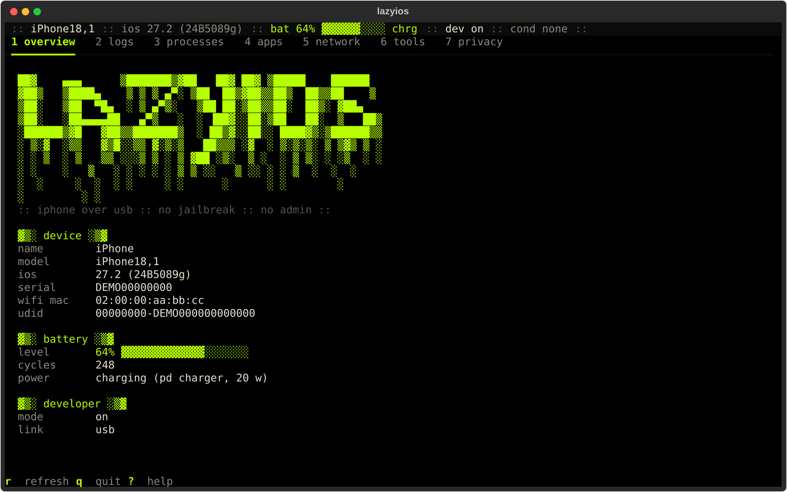

# lazyios

[](https://github.com/Manuel-1312/lazyios/actions/workflows/ci.yml)
[](LICENSE)

Like lazygit, but for your iPhone. A keyboard-driven terminal app that talks to an iPhone over USB: read the system log, list and kill processes, launch apps, capture network traffic to a `.pcap`, throttle the network, take screenshots, fake a location, watch FPS. It runs on Windows, macOS and Linux, needs no jailbreak, no Xcode and no admin rights. Built on [Textual](https://github.com/Textualize/textual), using [pymobiledevice3](https://github.com/doronz88/pymobiledevice3) as a library.



## Features

- overview: device info, battery (level, cycles, charger), developer mode state
- logs: live syslog with level colors, filter, pause, bounded buffer
- processes: list, filter, kill (with confirmation), launch by bundle id
- apps: installed user apps, launch with enter
- network: packet capture to a real `.pcap` with a live table, open in Wireshark; network, thermal and GPU conditions
- tools: screenshot, location simulation, FPS sparkline
- `--demo` runs on fake data, no device needed

## Install

Easiest first.

**1. Download a binary.** Grab `lazyios-windows-x64.exe`, `lazyios-macos-arm64` or `lazyios-linux-x64` from the [Releases](https://github.com/Manuel-1312/lazyios/releases) page and run it from a terminal. Nothing else to install (on macOS and Linux run `chmod +x` first).
The Windows exe is not code-signed, so SmartScreen may say "Windows protected your PC": click *More info*, then *Run anyway*. To check the download, compare its hash with the `SHA256SUMS` file from the same release:

```
Get-FileHash lazyios-windows-x64.exe -Algorithm SHA256   # PowerShell
sha256sum -c SHA256SUMS --ignore-missing                  # Linux
shasum -a 256 -c SHA256SUMS --ignore-missing              # macOS
```

**2. One-liner.** Installs [uv](https://docs.astral.sh/uv/) if needed, then lazyios. No admin or sudo.

```
irm https://raw.githubusercontent.com/Manuel-1312/lazyios/main/install.ps1 | iex      # Windows
curl -LsSf https://raw.githubusercontent.com/Manuel-1312/lazyios/main/install.sh | sh  # macOS, Linux
```

**3. With pipx or uv.**

```
pipx install git+https://github.com/Manuel-1312/lazyios
uv tool install git+https://github.com/Manuel-1312/lazyios
```

## Requirements

- An iPhone that trusts this computer. Developer Mode must be on for processes, conditions and tools.
- Windows: the Apple Devices app (`winget install 9NP83LWLPZ9K -s msstore`) or iTunes, for usbmuxd. If Apple Devices is installed but not running, lazyios starts it for you.
- macOS: nothing extra.
- Linux: the `usbmuxd` package (`sudo apt install usbmuxd` or your distro's equivalent).
- Python 3.10+ only for the pip/uv installs.

## Usage

```
lazyios [--udid UDID] [--out DIR] [--demo]
lazyios --version
lazyios --selftest
python -m lazyios
```

Captures and screenshots go to `~/lazyios/captures` and `~/lazyios/screenshots` unless `--out` says otherwise.

| key | action |
| --- | --- |
| `1`-`6` | switch tab |
| `q` | quit |
| `?` | help |
| `/` | focus filter (`esc` to leave) |
| `r` | refresh |
| `p` / `c` | logs: pause, clear |
| `k` / `l` | processes: kill, launch by bundle id |
| `enter` | apps: launch; network: apply condition; tools: set location |
| `space` / `o` | network: start/stop capture, open it |
| `x` | clear condition (network) or location (tools) |
| `s` / `o` | tools: screenshot, open it |
| `l` / `f` | tools: edit coordinates, start/stop FPS |

## Troubleshooting

**iPhone not detected on Windows.** Install Apple Devices from the Microsoft Store (or iTunes), plug the phone in with a data cable and unlock it. If the cable only charges, try another one.

**Failed to connect to usbmuxd.** usbmuxd is the service that talks to the phone over USB. On Windows open the Apple Devices app once (lazyios also tries to start it); with iTunes, start the "Apple Mobile Device Service" in `services.msc`. On Linux install the `usbmuxd` package and replug. macOS has it built in.

**"Trust This Computer" prompt.** Unlock the phone and tap *Trust*, then enter your passcode. Press `r` in lazyios to retry. If the prompt never shows, unplug, replug and unlock first.

**Developer Mode missing in Settings.** The switch under Settings > Privacy & Security stays hidden until the phone is asked to show it. With the phone plugged in and unlocked, run `uvx pymobiledevice3 amfi reveal-developer-mode`, then turn Developer Mode on in Settings and let the phone restart.

**iOS 17+ tunnel / no admin.** Newer iOS versions need a tunnel for developer services. lazyios builds it inside the process with a userspace network stack, so no root or admin is needed. It opens on first use and takes a few seconds.

**Launching an app does nothing.** The phone has to be unlocked.

## How it compares

libimobiledevice and `idevicesyslog` are single-purpose command line tools, and Xcode's Devices window needs a Mac. lazyios puts the common bits (logs, processes, apps, packet capture, network conditions) in one interactive terminal app that runs anywhere Python or the standalone binary does.

## Notes

- Capture files contain your traffic. Treat them as sensitive.
- An active condition is shown in red in the status line. Conditions and simulated location are cleared when you quit.

## Credits

[pymobiledevice3](https://github.com/doronz88/pymobiledevice3) by doronz88 and contributors does all the device work. The interface is [Textual](https://github.com/Textualize/textual).

## License

Copyright (C) 2026 Manuel Sánchez

GPL-3.0-or-later, see [LICENSE](LICENSE).
